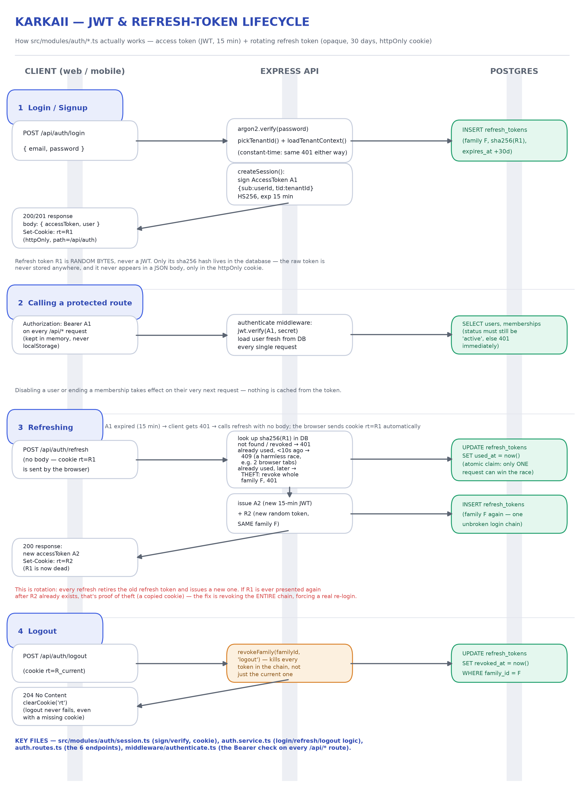

# Karkaii API (backend)

Multi-school ERP backend. Node.js 22 + Express 5 + TypeScript + Drizzle ORM + PostgreSQL.

**This is not a starter kit anymore** — auth, multi-tenancy (one account, many schools) and role/permission
checks are already built and working. If you're new to this stack, read this file top to bottom before
touching code; it explains the *why*, not just the *how*.

## 1. What this backend actually does

One person signs up once. They can belong to several schools ("organizations" in the code) with a
**different role in each one** — owner in one, teacher in another. Every request is checked against that
person's permissions **in the school they're currently acting as**. That's the one idea the whole auth layer
exists to support — keep it in mind and the rest of this doc makes sense.

| Term in the code | What it means in plain words |
|---|---|
| `User` | A person. One row, one login, used across every school they belong to. |
| `Organization` | A school/tenant. Data never leaks between organizations. |
| `Membership` | "This user belongs to this school" — the join between the two. |
| `Role` / `Permission` | What a membership is allowed to do (`students.read`, `fees.write`, …). |
| `RefreshToken` | One row per active login session (see the JWT section below). |

## 2. Tech stack, and why each piece is there

| Piece | Library | Why |
|---|---|---|
| HTTP server | Express 5 | Minimal, everyone's seen it before, easy to reason about top-to-bottom. |
| Language | TypeScript | Catches "undefined is not a function" at compile time, not in production. |
| Database | PostgreSQL 16 (Docker locally) | Relational — schools/users/roles are inherently relational data. |
| ORM | Drizzle ORM + `pg` (node-postgres) | TypeScript-first, no separate query-engine process, close to raw SQL. |
| Passwords | `argon2` | The current best-practice password hash (not bcrypt, not plain SHA). |
| Access tokens | `jsonwebtoken` (JWT) | Short-lived, stateless, verified without hitting the DB for the signature itself. |
| Validation | `zod` | Every request body is parsed through a schema before it touches business logic. |
| Security headers / CORS / rate limiting | `helmet`, `cors`, `express-rate-limit` | Baseline hardening, applied once in `app.ts`. |
| API docs | `swagger-ui-express` + `zod-to-openapi` | `/api/docs` — live, generated from the same Zod schemas that validate requests. |
| Logging | `pino` + `pino-http` | Structured JSON request logs in production, pretty-printed in dev; see `src/lib/logger.ts`. |
| Linting / formatting | `eslint` (flat config) + `prettier` | `npm run lint` / `npm run format` — run before committing. |
| Tests | `vitest` + `supertest` | `npm test` — real HTTP requests against `createApp()`, no mocking, needs a running database. |

> **Migrated from Prisma to Drizzle on 2026-11-11** (before the 14 upcoming modules — students, fees,
> timetable, … — landed on top of the auth/tenant foundation, the cheapest point to switch). The schema lives
> in `src/db/schema.ts`, migrations in `drizzle/`. If you're setting up a **brand-new, empty** database, just
> run `npm run db:migrate`. If you're pointing at a database that still has these 9 tables from the old Prisma
> setup (a teammate's existing local DB, the parked Supabase instance), run
> `npx tsx scripts/baseline-drizzle-migration.ts` once first — it marks the initial migration as already
> applied without re-running its `CREATE TABLE` statements (which would fail with "already exists").

## 3. Project layout

Every file in the repo, what it's for. Generated code (`node_modules/`, `dist/`) and the curl/httpie scratch
files the `.gitignore` already excludes (`jar.txt`, `*.json` response dumps, etc.) are left out.

```
backend/
├── src/
│   ├── app.ts                      — builds the Express app: security middleware, request logging, routes, error
│   │                                  handler, IN THAT ORDER (the comment at the top of the file explains why order
│   │                                  is part of the security design, not just style)
│   ├── server.ts                   — the only file that actually starts listening on a port; app.ts is imported
│   │                                  by this AND by the tests, so tests never need a real network port
│   ├── config.ts                   — reads and validates every .env variable with zod; crashes on boot with a
│   │                                  readable message if one is missing, instead of failing later with `undefined`
│   ├── db.ts                       — the one shared `pg` Pool + Drizzle instance every module imports
│   ├── db/schema.ts                — every table, column, index and foreign key - the single source of truth
│   │                                  (drizzle-kit generates drizzle/*.sql migrations from this file)
│   ├── permissions.ts              — the full permission catalogue: MODULES × ACTIONS → `module.action` codes,
│   │                                  and DEFAULT_ROLES (owner/admin/teacher/…) as named bundles of those codes
│   ├── seed.ts                     — CLI script (`npm run db:seed`): loads the permission catalogue into the
│   │                                  database and creates a fallback demo school + login, idempotent
│   │
│   ├── middleware/
│   │   ├── authenticate.ts         — verifies the `Authorization: Bearer <token>` JWT, loads the caller fresh
│   │   │                              from the DB every request, sets req.user / req.tenant
│   │   ├── requirePermission.ts    — route guard: `requirePermission('students.read')` → 403 if the caller's
│   │   │                              role in the active school doesn't grant that code
│   │   └── errorHandler.ts         — the LAST middleware (see app.ts); turns any thrown/rejected error into the
│   │                                  one consistent JSON error shape, logs 500s via lib/logger.ts
│   │
│   ├── modules/                    — one folder per feature; each follows routes → schemas → service
│   │   ├── auth/
│   │   │   ├── auth.routes.ts      — the 6 HTTP endpoints: signup, login, refresh, logout, /me, switch-organization
│   │   │   ├── auth.schemas.ts     — zod request-body schemas for the routes above
│   │   │   ├── auth.service.ts     — the actual signup/login/refresh/logout/switch business logic
│   │   │   └── session.ts          — signs/verifies the access JWT, sets/clears the refresh-token cookie, the
│   │   │                              `toFrontendUser`/`sendSession` helpers every auth response goes through
│   │   ├── organizations/
│   │   │   ├── organizations.routes.ts    — create a school, list mine, view/edit the active one
│   │   │   ├── organizations.schemas.ts   — zod schemas for the above
│   │   │   └── organizations.service.ts   — creating a school is one all-or-nothing transaction (school + its
│   │   │                                     12 default roles + the creator as owner)
│   │   ├── members/
│   │   │   ├── members.routes.ts   — add/remove a person from the active school, change their role
│   │   │   ├── members.schemas.ts  — zod schemas for the above
│   │   │   └── members.service.ts  — the business logic behind those routes
│   │   └── roles/
│   │       ├── roles.routes.ts     — CRUD for custom roles; also serves GET /api/permissions
│   │       ├── roles.schemas.ts    — zod schemas for the above
│   │       └── roles.service.ts    — the business logic behind those routes
│   │
│   ├── lib/                        — shared code with no HTTP awareness (no req/res in here)
│   │   ├── tenant.ts               — THE core tenancy logic: "this user's roles + permissions in this school",
│   │   │                              used by authenticate.ts and requirePermission.ts alike
│   │   ├── errors.ts               — the `HttpError` class (status + message + optional field errors)
│   │   ├── respond.ts              — `ok()` / `created()` / `noContent()` — the one response envelope shape
│   │   ├── hash.ts                 — sha256 helper, used to hash refresh tokens before they touch the database
│   │   ├── bigint.ts               — teaches `JSON.stringify` to serialize BigInt ids (src/db/schema.ts uses
│   │   │                              `{ mode: "bigint" }` for every primary key; plain JSON.stringify throws on those without this)
│   │   └── logger.ts               — the shared `pino` logger instance (pretty-printed in dev, plain JSON in prod)
│   │
│   ├── docs/                       — OpenAPI/Swagger generation (this is application code, not reference material)
│   │   ├── docs.routes.ts          — mounts /api/docs (Swagger UI) and /api/openapi.json, off in production
│   │   ├── openapi.ts              — builds the OpenAPI document from the zod-to-openapi registry
│   │   └── schemas.ts              — registers each module's zod schemas into that OpenAPI document
│   │
│   └── types/
│       └── express.d.ts            — augments Express's own `Request` type with `req.user` / `req.tenant`
│
├── drizzle/                         — generated migration SQL (drizzle-kit generate) - never hand-edit these
│   ├── 0000_complete_true_believers.sql
│   └── meta/                       — drizzle-kit's own bookkeeping (_journal.json, snapshots)
│
├── tests/                          — vitest + supertest, real HTTP calls against createApp(), no mocking
│   ├── setup.ts                    — raises the auth rate limit and silences logs for the test run (runs before
│   │                                  dotenv/config in vitest.config.ts, so its values win over .env)
│   ├── helpers.ts                  — shared `app`, unique email/slug generators, the `signupAndLogin` test helper
│   ├── auth.test.ts                — signup, login, refresh rotation, reuse/theft detection, logout
│   └── organizations.test.ts       — create/switch a school, tenant-scoped 403s, duplicate-slug 409
│
├── scripts/
│   ├── check-all.sh                — 60 end-to-end checks against a LIVE running API (not vitest - needs
│   │                                  `./demo.sh up` first); never deletes data, safe to re-run
│   ├── demo-api.sh                 — scripted curl walkthrough of the main API flows, for manual exploration
│   └── baseline-drizzle-migration.ts — one-time step for a database that already has these tables from the
│                                      old Prisma setup; see the ORM migration note above
│
├── exercises/                      — empty (.gitkeep only); leftover from the original learning-curriculum
│                                      scaffold, safe to delete now that the backend is actually built
│
├── .github/
│   ├── workflows/deploy.yml        — CI: type-check + build on every push to main, then deploys over SSH
│   └── assets/jwt-flow-diagram.png — the diagram embedded in §5 below (kept here, not under docs/, so it's
│                                      actually tracked by git and renders for anyone who clones the repo)
├── docker-compose.yml              — local PostgreSQL only (container `karkaii-pg`, port 5432)
├── drizzle.config.ts               — tells drizzle-kit where the schema and migrations live, and which
│                                      connection to use for them (DIRECT_URL, same reasoning as Supabase's)
├── env.template                    — copy to `.env`; documents every variable, local AND Supabase connection
│                                      string shapes (see §4)
├── eslint.config.js                — flat ESLint config (typescript-eslint + eslint-config-prettier)
├── .prettierrc.json / .prettierignore
├── tsconfig.json / tsconfig.build.json   — the dev (noEmit, for typecheck) and the build (emits to dist/) configs
├── vitest.config.ts                — test runner config: one shared database, 30s timeouts (argon2 is slow
│                                      on purpose), loads tests/setup.ts then .env
└── package.json
```

**Read the files in this order** if you're onboarding: `config.ts` → `app.ts` → `middleware/authenticate.ts` →
`modules/auth/session.ts` → `modules/auth/auth.service.ts` → `lib/tenant.ts`. That's the whole security model.

## 4. Getting it running locally

1. Install **Node 22** and **Docker**.
2. From this folder:
   ```bash
   npm install
   docker compose up -d                 # starts local PostgreSQL on :5432 (container: karkaii-pg)
   cp env.template .env
   ```
3. Open `.env` and replace `JWT_ACCESS_SECRET` with a real secret:
   ```bash
   openssl rand -hex 32
   ```
   Paste the output in. **Never reuse the placeholder value** and never commit `.env`.
4. Create the database tables and seed a demo account:
   ```bash
   npm run db:migrate
   npm run db:seed
   ```
5. Start the API:
   ```bash
   npm run dev
   ```
6. Confirm it's alive: open http://localhost:5000/api/health — you should see `{"data":{"status":"ok"}}`.
   If this 500s, Postgres isn't running — check `docker ps` for `karkaii-pg` and `docker start karkaii-pg` if
   it's stopped (it does **not** auto-restart after a reboot).
7. Try logging in with the seeded demo account (see `src/seed.ts` for the exact email/password) against
   `POST /api/auth/login`, or open http://localhost:5000/api/docs for a live, click-to-try API explorer.

## 5. The JWT / session flow

The short version: **access tokens are JWTs, refresh tokens are not.**

- **Access token** — a signed JWT (`{ sub: userId, tid: organizationId }`), lives **15 minutes**, sent as
  `Authorization: Bearer <token>` on every request, verified without a database round-trip for its signature
  (though the user is still re-loaded from the DB on every request, so disabling someone takes effect
  immediately).
- **Refresh token** — a random 48-byte value, lives **30 days**, sent only as an `httpOnly` cookie scoped to
  `/api/auth/*` (JavaScript on the page can never read it). Only its SHA-256 hash is ever stored in the
  database. Each time it's used, it's **rotated**: the old one is marked used and a brand-new one takes its
  place in the same "family" (login chain). If an already-used refresh token is ever presented again, that's
  treated as **theft** and the entire family is revoked — forcing a real re-login.

Full lifecycle — login, using a token, refreshing, logout, and the theft-detection path — is diagrammed below:



The code for all of this lives in exactly four files: `modules/auth/session.ts` (sign/verify, cookies),
`modules/auth/auth.service.ts` (the login/refresh/logout business logic), `modules/auth/auth.routes.ts` (the
6 HTTP endpoints), `middleware/authenticate.ts` (the check every protected route goes through).

## 6. Scripts

| Command | What it does |
|---|---|
| `npm run dev` | Starts the API with auto-restart on file changes. |
| `npm run build` / `npm start` | Compiles to `dist/` and runs the compiled JS (what production runs). |
| `npm run typecheck` | TypeScript check with no build output — run this before committing. |
| `npm test` | Runs the Vitest suite. |
| `npm run db:generate` | Diffs `src/db/schema.ts` against the last migration and writes a new `drizzle/*.sql` file. |
| `npm run db:migrate` | Applies any not-yet-applied `drizzle/*.sql` migrations to your database. |
| `npm run db:seed` | Re-runs `src/seed.ts` (idempotent — safe to run again). |
| `npm run db:studio` | Opens Drizzle Studio, a GUI for browsing the local database. |

## 7. Where to go next

- `scripts/check-all.sh` — 60 end-to-end checks against a live API; `scripts/demo-api.sh` for a scripted
  curl walkthrough of the main flows.
- Ask your team lead for the ERD, the build guide, and the login/token sequence-diagram reference material —
  it's kept locally, not in this repo.
- The project-wide onboarding doc your team lead shared alongside this README covers the **14 modules**
  being built next (Admission, Students, Staff, Fees, Timetable, …) and the exact database fields for each.

## 8. Rules

- Never commit `.env` or anything containing a real database password or JWT secret.
- Keep dependency versions as they are in `package.json`; upgrade one library at a time, deliberately.
- Run `npm run typecheck` and `npm test` before opening a PR.
